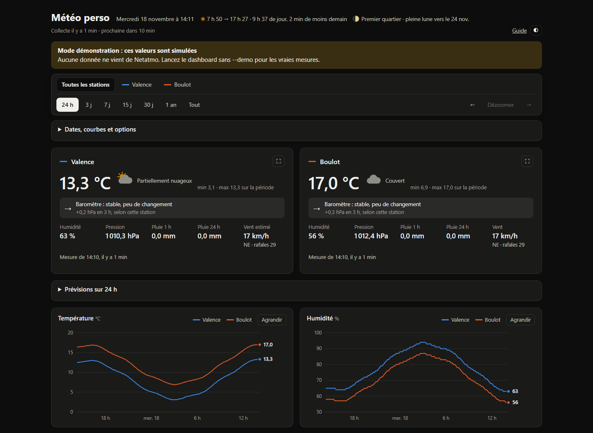
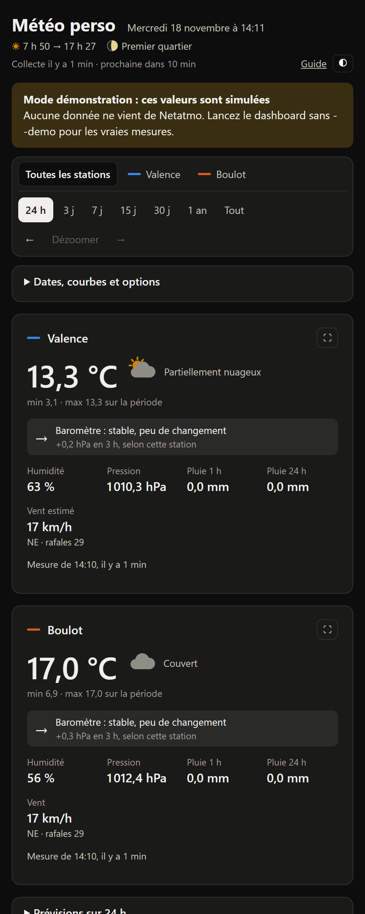

# Météo · a dashboard for Netatmo weather stations

[Version française](README.md)

A self-hosted weather dashboard. It follows **public** Netatmo stations, either your own or any
station on the Netatmo map. It keeps every reading in a SQLite database and draws the charts in
the browser. It needs only Python: no library to install, and no third-party service apart from
the weather sources listed below.





**The interface is in French only.**

## What it does

- **Charts** of temperature, humidity, pressure, wind and rain, from 24 hours to the whole
  history.
  - To zoom, drag across a chart with the mouse, or spread two fingers on a phone.
  - The options "Min/max par jour" (daily min/max) and "Comparer à l'an dernier" (compare with
    last year) add detail to the charts.
  - Rain is shown as daily or monthly totals.
- **History**: on the first start, up to two years of readings are fetched from Netatmo. Gaps
  left while the computer was off fill in by themselves afterwards.
- **Sky and forecast**, hour by hour and for 15 days, from [Open-Meteo](https://open-meteo.com/).
  Stations without an anemometer get an estimated wind.
- **Official warnings** in yellow, orange and red, from [MeteoAlarm](https://meteoalarm.org/).
- **Barometer**: a trend for the next 6 to 12 hours, worked out from the station's own pressure
  only.
- **Neighbouring stations**: the median of the public stations 1 to 10 km away. It helps spot a
  badly placed station.
- **Stats and records** for the period shown.
- **Sun and moon**: sunrise and sunset times, and the phase of the moon.
- **Full screen** for a tablet or a dedicated screen, with a direct address
  (`/?ecran=<station>`).
- Several colour **themes**, and a layout that works on phones.

## Two versions

| | Local version (main folder) | Online version (`version-vps/`) |
|---|---|---|
| For | one PC, one person | a server, several people |
| Address | `http://localhost:8765` | your domain, over HTTPS |
| Accounts | none | by invitation, with an admin page |
| Collection | while the PC is on | all the time |
| Version | 1.5 | 2.0 |

The online version adds an app that can be installed on phones and PCs. It also has an admin
page:
- server status;
- limits;
- a message for everyone;
- which options people use;
- a database backup.

A station followed by several people is collected only once.

## Try it without an account

```bash
python app.py --demo
```

On Windows, double-click `lancer-demo.bat`. The values are simulated, and the page clearly says
so.

## Install the local version

1. Install [Python](https://www.python.org/) 3 (tested with 3.13).
2. On [dev.netatmo.com](https://dev.netatmo.com), create an app under "My Apps". If a
   "redirect URI" is asked for, enter `http://localhost:8765/callback`.
3. Run `python app.py`, or `lancer.bat` on Windows. On the first start, `config.json` is created
   from `config.example.json`. Fill in `client_id` and `client_secret`, then start again.
4. Open <http://localhost:8765>, click "Connecter mon compte Netatmo" (connect my Netatmo
   account), then add a station.

**Adding a station:** on the [Netatmo map](https://weathermap.netatmo.com), click the station
and copy the page address, which contains `stationid=…`.
1. In the dashboard, choose "Ajouter une station" (add a station).
2. Paste that link.
3. Give the town or the coordinates, because the link does not contain the position.

You can add up to 8 stations.

The **Guide** page inside the app explains every feature, in French.

## Install the online version

See [version-vps/INSTALLER-VPS.md](version-vps/INSTALLER-VPS.md) (in French). It runs in Docker
with the official Python image. A Cloudflare tunnel provides HTTPS without opening any port.

## Data and privacy

- `config.json`, `data/` and `token.json` hold your secrets and your readings: do not share them.
  The `.gitignore` file keeps them out of the repository.
- The program only contacts:
  - the official Netatmo API;
  - Open-Meteo, for the forecast and the estimated wind;
  - MeteoAlarm, for the warnings;
  - `data.geopf.fr` and `geocoding-api.open-meteo.com`, to look up a town.
- There are no ads, no analytics, and no scripts loaded from other sites.
- `meteoalarm-ca.pem` is a public certificate. MeteoAlarm's server does not send its
  intermediate certificate, so this file is needed to check the connection to it.

## Tests

```bash
python -m unittest discover
```

Run it in the main folder, then in `version-vps/`.

## Sources and licences

- Code: [MIT](LICENSE) licence.
- Forecast and estimated wind: [Open-Meteo.com](https://open-meteo.com/), CC BY 4.0. Free for
  non-commercial use.
- Warnings: [MeteoAlarm](https://meteoalarm.org/), EUMETNET, CC BY 4.0.
- Readings: the official Netatmo API. Everyone creates their own Netatmo app.

This is a personal project, shared as is, with no warranty and no support. The warnings it shows
do not replace official sources.
