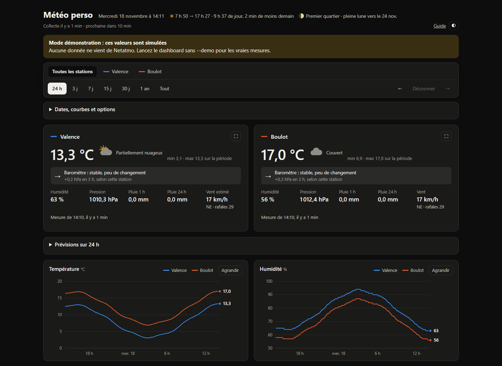
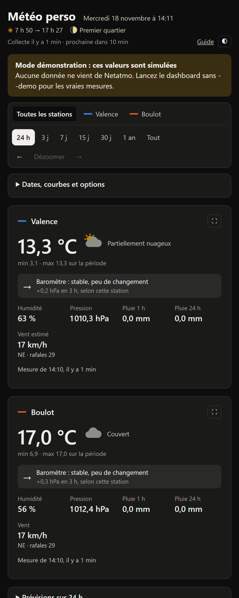

# Météo · tableau de bord pour stations Netatmo

[](https://github.com/nyxsauventreen-commits/meteo-netatmo/actions/workflows/tests.yml)
[English version](README.en.md)

Un tableau de bord météo à héberger soi-même. Il suit des stations Netatmo **publiques**, les
vôtres ou celles de la carte Netatmo, garde chaque mesure dans une base SQLite et les affiche
en courbes dans le navigateur. Il demande seulement Python : aucune bibliothèque à installer,
aucun service tiers en dehors des sources météo citées plus bas.





## Ce qu'il fait

- **Courbes** de température, humidité, pression, vent et pluie, de 24 heures à tout
  l'historique. On zoome en glissant sur une courbe à la souris, ou en écartant deux doigts
  sur un téléphone. Les options
  « Min/max par jour » et « Comparer à l'an dernier » enrichissent les courbes. La pluie
  s'affiche en cumuls par jour ou par mois.
- **Historique** : au premier lancement, jusqu'à deux ans de mesures sont récupérés chez Netatmo.
  Les trous laissés quand l'ordinateur est éteint se comblent ensuite tout seuls.
- **Ciel et prévisions** heure par heure et sur 15 jours ([Open-Meteo](https://open-meteo.com/)).
  Un vent estimé s'affiche pour les stations sans anémomètre.
- **Alertes officielles** jaunes, orange et rouges ([MeteoAlarm](https://meteoalarm.org/)).
- **Notifications** envoyées par le site lui-même, sans appli à installer (téléphone, tablette,
  PC), ou par e-mail : vigilances, gel, chaleur, forte pluie, rafales et station muette. Chacun
  choisit ses événements et ses seuils.
- **Baromètre** : une tendance pour les 6 à 12 prochaines heures, calculée seulement avec la
  pression de la station.
- **Stations voisines** : la médiane des stations publiques situées entre 1 et 10 km, pour
  repérer une station mal placée.
- **Stats et records** sur la période affichée.
- **Soleil et lune** : lever et coucher du soleil, et phase de la lune.
- **Plein écran** pour une tablette ou un écran dédié, avec une adresse directe
  (`/?ecran=<station>`).
- Plusieurs **thèmes** de couleurs, et un affichage adapté au téléphone.

L'interface est en français.

## Un programme, deux modes

Le même programme (version 2.3) tourne sur un PC ou sur un serveur. Le mode se choisit au
lancement.

| | Mode local (par défaut) | Mode en ligne |
|---|---|---|
| Pour | un PC, une seule personne | un serveur, plusieurs personnes |
| Accès | `http://localhost:8765` | votre domaine, en HTTPS |
| Comptes | aucun, mot de passe facultatif | sur invitation, avec une page d'administration |
| Collecte | quand le PC est allumé | en continu |
| Lancement | `python app.py` | `METEO_INVITE_CODE` défini, dans Docker |

Les deux modes ont les mêmes écrans et peuvent s'installer comme une appli sur téléphone et
sur PC. Le mode en ligne ajoute une page d'administration : état du serveur, limites, message
pour tous, options utilisées et sauvegarde de la base. Une station suivie par plusieurs
personnes n'y est collectée qu'une fois.

## Essayer sans compte

```bash
python app.py --demo
```

Sous Windows, double-cliquez sur `lancer-demo.bat`. Les valeurs sont simulées, et la page
l'indique clairement.

## Installer sur un PC

1. Installez [Python](https://www.python.org/) 3 (version testée : 3.13).
2. Sur [dev.netatmo.com](https://dev.netatmo.com), créez une application dans « My Apps ».
   Si un champ « redirect URI » est demandé, indiquez `http://localhost:8765/callback`.
3. Lancez `python app.py`, ou `lancer.bat` sous Windows. Au premier lancement, `config.json`
   est créé à partir de `config.example.json`. Renseignez-y `client_id` et `client_secret`,
   puis relancez.
4. Ouvrez <http://localhost:8765>, cliquez sur « Connecter mon compte Netatmo », puis ajoutez
   une station.

**Ajouter une station :** sur la [carte Netatmo](https://weathermap.netatmo.com), cliquez
sur la station et copiez l'adresse de la page, qui contient `stationid=…`. Dans le tableau
de bord, choisissez « Ajouter une station », collez ce lien, puis indiquez la commune ou des
coordonnées : le lien ne contient pas la position. Vous pouvez ajouter 8 stations au plus.

La page **Guide**, dans l'application, détaille chaque fonction.

## Installer sur un serveur

Voir [version-vps/INSTALLER-VPS.md](version-vps/INSTALLER-VPS.md). Le programme tourne dans
Docker avec l'image Python officielle, et un tunnel Cloudflare fournit le HTTPS sans ouvrir de
port. Le dossier `version-vps/` contient seulement les outils d'installation et de mise à jour.

## Données et vie privée

- `config.json`, `data/` et `token.json` contiennent vos secrets et vos mesures : ne les
  partagez pas. Le fichier `.gitignore` les tient hors du dépôt.
- Le programme contacte seulement :
  - l'API officielle Netatmo ;
  - Open-Meteo, pour les prévisions et le vent estimé ;
  - MeteoAlarm, pour les alertes ;
  - `data.geopf.fr` et `geocoding-api.open-meteo.com`, pour retrouver une commune ;
  - seulement si quelqu'un active les notifications : le service de notification de son
    navigateur (Google, Mozilla, Apple ou Microsoft), qui reçoit un signal vide, et Gmail pour les
    e-mails.
- Il n'y a ni publicité, ni mesure d'audience, ni script venu d'un autre site.
- Le fichier `meteoalarm-ca.pem` est un certificat public. Il permet de vérifier la
  connexion à MeteoAlarm, dont le serveur n'envoie pas son certificat intermédiaire.

## Tests

```bash
python -m unittest discover
```

Lancez cette commande dans le dossier principal, puis dans `version-vps/`.

## Sources et licences

- Code : licence [MIT](LICENSE).
- Prévisions et vent estimé : [Open-Meteo.com](https://open-meteo.com/), CC BY 4.0.
  Le service est gratuit pour un usage non commercial.
- Alertes : [MeteoAlarm](https://meteoalarm.org/), EUMETNET, CC BY 4.0.
- Mesures : API officielle Netatmo. Chacun crée sa propre application Netatmo.

Ce projet personnel est partagé tel quel, sans garantie ni support. Les vigilances affichées
ne remplacent pas les sources officielles.
